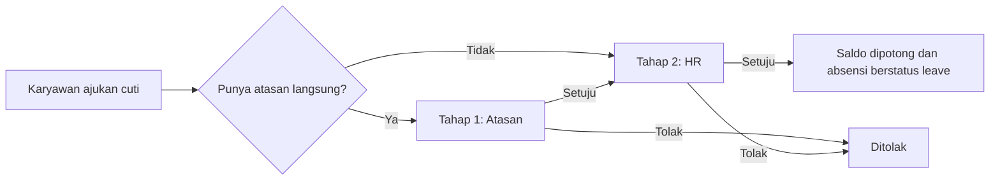
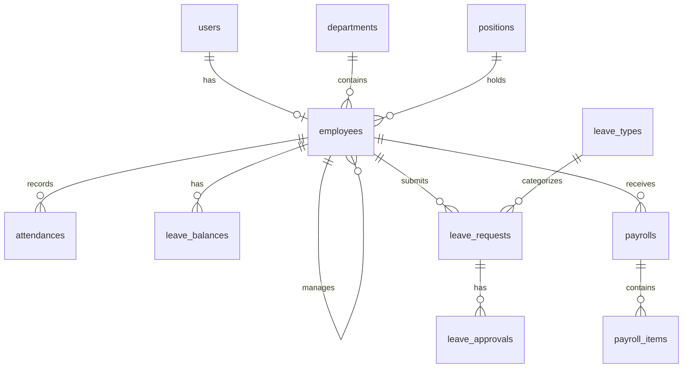

# HRIS API

Backend sistem HRIS (Human Resource Information System) untuk perusahaan skala kecil-menengah:
absensi berbasis lokasi, cuti dengan approval bertingkat, dan payroll lengkap dengan slip gaji PDF.
Dibuat dengan Laravel 12 sebagai REST API, dilengkapi feature test dan dokumentasi OpenAPI otomatis.

> **Demo live:** _(isi setelah deploy)_ · **Frontend:** _(repo hris-web, menyusul)_

## Fitur

- **Autentikasi & role**: token Sanctum, 4 role (Super Admin, HR, Manager, Karyawan), akses dicek lewat Middleware dan Policy.
- **Master data**: departemen, jabatan, karyawan (nonaktif, bukan hapus, supaya riwayat tetap utuh).
- **Absensi**: clock in/out dengan validasi radius kantor (rumus Haversine), status telat otomatis dari jam server, rekap bulanan.
- **Cuti**: pengajuan, approval bertingkat atasan → HR, saldo cuti, sinkron otomatis ke absensi.
- **Payroll**: komponen gaji, lembur, potongan absen, gaji proporsional untuk karyawan baru, draft → final, slip gaji PDF, export Excel.

## Tech stack

Laravel 12 · PHP 8.2+ · MySQL · Laravel Sanctum · dompdf · Maatwebsite Excel · Scramble (OpenAPI) · PHPUnit

## Alur approval cuti



## Relasi database



## Menjalankan secara lokal

```bash
git clone <url-repo>
cd hris-api
composer install
cp .env.example .env
php artisan key:generate
```

Atur koneksi database di `.env`, buat database kosong bernama `hris`, lalu:

```bash
php artisan migrate:fresh --seed --seeder=DemoSeeder
php artisan serve
```

## Akun demo

Semua password: `password`

| Email | Role |
|---|---|
| admin@hris.test | Super Admin |
| hr@hris.test | HR |
| manager@hris.test | Manager (IT) |
| dian@hris.test | Manager (Finance) |
| andi@hris.test | Karyawan (IT) |

## Dokumentasi API

- Interaktif (saat `APP_ENV=local`): `http://127.0.0.1:8000/docs/api`
- File OpenAPI: [`docs/openapi.json`](docs/openapi.json), bisa di-import ke Postman atau Thunder Client.

Perbarui file OpenAPI dengan:

```bash
php artisan scramble:export --path=docs/openapi.json
```

## Testing

```bash
php artisan test
```

Feature test mencakup auth, hak akses per role, master data, absensi, cuti (termasuk saldo dan approval),
payroll (termasuk lembur, proporsional, dan PDF/Excel), seeder demo, dan kelengkapan dokumentasi API.
Tes memakai SQLite in-memory dengan waktu yang dikunci, jadi hasilnya konsisten.

## Aturan bisnis penting

**Cuti**
- Hanya hari kerja (Senin-Jumat) yang dihitung.
- Pengajuan yang masih menunggu ikut "memesan" kuota, jadi saldo tidak bisa diajukan dua kali.
- Saldo dipotong di persetujuan terakhir dan dicek ulang saat itu.
- Karyawan tidak bisa menyetujui pengajuannya sendiri.

**Payroll**
- Gaji bersih = gaji pokok + pendapatan (tunjangan + lembur) − potongan (BPJS + absen).
- Potongan absen = gaji pokok ÷ hari kerja sebulan × hari absen. Hari cuti yang disetujui tidak dipotong.
- Lembur: jam penuh setelah jam kerja, maksimal 4 jam per hari. Upah per jam = gaji pokok ÷ 173, jam pertama 1,5×, berikutnya 2×.
- Payroll hanya bisa dihitung untuk bulan yang sudah berakhir. Yang sudah final tidak bisa dihitung ulang atau dihapus.
- Slip gaji menyimpan snapshot rincian, jadi tidak berubah walau komponen gaji diubah kemudian.

## Keputusan teknis

- Logika cuti dan payroll ada di Service class, bukan di controller, supaya mudah dites.
- Validasi lokasi absensi dilakukan di server, bukan di klien.
- Perubahan saldo dan approval memakai transaksi database dan row lock untuk mencegah race condition.
- Karyawan dinonaktifkan (soft state), bukan dihapus, karena data absensi, cuti, dan payroll bergantung padanya.

## Batasan yang disadari (rencana fase 2)

- GPS dari HP bisa dipalsukan. Rencananya ditambah verifikasi selfie.
- Belum ada PPh 21, plafon iuran BPJS, THR, dan hari libur nasional.
- Komponen gaji berlaku sama untuk semua karyawan aktif.
- Belum ada notifikasi email dan audit log.
