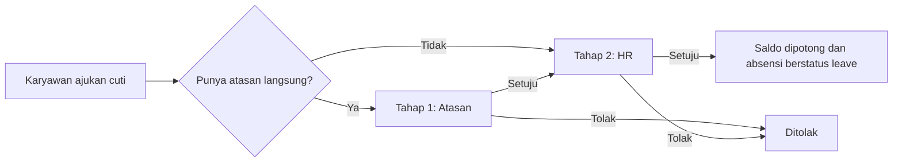
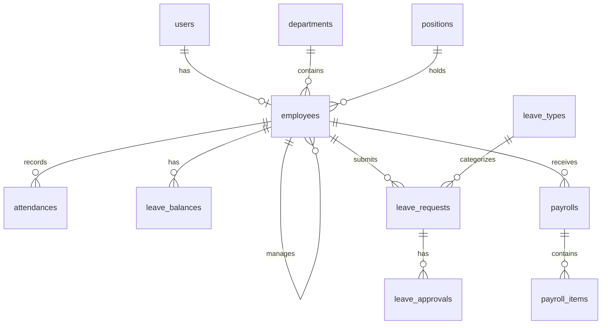

# HRIS API


Backend sistem HRIS (Human Resource Information System): absensi, cuti dengan persetujuan bertingkat,
dan payroll lengkap dengan slip gaji PDF. Dibuat dengan Laravel 12 sebagai REST API,
dengan lebih dari 120 feature test dan dokumentasi OpenAPI otomatis.

- **Frontend (React + TypeScript):** [hris-web](https://github.com/Manfarisi/hris-web), berisi screenshot

## Fitur

- **Autentikasi dan role**: token Sanctum, 4 role (Super Admin, HR, Manager, Karyawan), akses dicek lewat Middleware dan Policy.
- **Master data**: departemen, jabatan, karyawan (dinonaktifkan, bukan dihapus, supaya riwayat tetap utuh).
- **Absensi**: clock in/out dengan jam dari server (tidak bisa dimanipulasi dari klien), status telat otomatis,
  rekap bulanan. Validasi radius kantor (Haversine) bersifat **opsional** lewat `HRIS_REQUIRE_LOCATION`.
- **Cuti**: pengajuan, persetujuan bertingkat atasan lalu HR, saldo cuti, sinkron otomatis ke absensi.
- **Payroll**: komponen gaji, lembur, potongan absen, gaji proporsional untuk karyawan baru,
  draft lalu final, slip gaji PDF, export Excel.

## Tech stack

Laravel 12 · PHP 8.2+ · MySQL · Laravel Sanctum · dompdf · Maatwebsite Excel · Scramble (OpenAPI) · PHPUnit · GitHub Actions

## Alur persetujuan cuti



## Relasi database



## Menjalankan secara lokal

```bash
git clone https://github.com/Manfarisi/hris-api.git
cd hris-api
composer install
cp .env.example .env
php artisan key:generate
```

Atur koneksi database di `.env`, buat database kosong bernama `hris`, lalu:

```bash
php artisan migrate:fresh --seed --seeder=DemoSeeder
php artisan serve
```

Lalu jalankan frontend dari repo [hris-web](https://github.com/Manfarisi/hris-web).
Di Windows PowerShell, pakai `copy` sebagai pengganti `cp`.

## Pengaturan (`.env`)

| Variabel | Default | Fungsi |
|---|---|---|
| `HRIS_WORK_START` / `HRIS_WORK_END` | `08:00` / `17:00` | Jam kerja |
| `HRIS_LATE_TOLERANCE` | `0` | Toleransi keterlambatan (menit) |
| `HRIS_REQUIRE_LOCATION` | `false` | `true` = clock in/out hanya sah di radius kantor |
| `HRIS_PAYROLL_ALLOW_OPEN_MONTH` | `false` | Izinkan hitung payroll bulan yang belum berakhir (untuk demo) |
| `HRIS_COMPANY_NAME` | `PT Contoh Sejahtera` | Nama di slip gaji |
| `CORS_ALLOWED_ORIGINS` | `localhost:5173` | Origin frontend yang diizinkan |

## Akun demo

Semua password: `password`

| Email | Role |
|---|---|
| admin@hris.test | Super Admin |
| hr@hris.test | HR |
| manager@hris.test | Manager (IT) |
| dian@hris.test | Manager (Finance) |
| andi@hris.test | Karyawan (IT) |

## Dokumentasi API

- Interaktif (saat `APP_ENV=local`): `http://127.0.0.1:8000/docs/api`
- File OpenAPI: [`docs/openapi.json`](docs/openapi.json), bisa di-import ke Postman atau Thunder Client.

Perbarui file OpenAPI dengan:

```bash
php artisan scramble:export --path=docs/openapi.json
```

## Testing dan CI

```bash
php artisan test
```

Feature test mencakup auth, hak akses per role, master data, absensi (dengan dan tanpa validasi lokasi),
cuti (saldo dan persetujuan), payroll (lembur, proporsional, PDF dan Excel), perlindungan akun sendiri,
seeder demo, CORS, dan kelengkapan dokumentasi API. Tes memakai SQLite in-memory dengan waktu yang dikunci,
jadi hasilnya konsisten. GitHub Actions menjalankan seluruh tes di setiap push.

## Aturan bisnis penting

**Cuti**
- Hanya hari kerja (Senin sampai Jumat) yang dihitung.
- Pengajuan yang masih menunggu ikut "memesan" kuota, jadi saldo tidak bisa diajukan dua kali.
- Saldo dipotong di persetujuan terakhir dan dicek ulang saat itu.
- Karyawan tidak bisa menyetujui pengajuannya sendiri.

**Payroll**
- Gaji bersih = gaji pokok + pendapatan (tunjangan + lembur) − potongan (BPJS + absen).
- Potongan absen = gaji pokok ÷ hari kerja sebulan × hari absen. Hari cuti yang disetujui tidak dipotong.
- Lembur: jam penuh setelah jam kerja, maksimal 4 jam per hari. Upah per jam = gaji pokok ÷ 173, jam pertama 1,5×, berikutnya 2×.
- Payroll hanya bisa dihitung untuk bulan yang sudah berakhir. Yang sudah final tidak bisa dihitung ulang atau dihapus.
- Slip gaji menyimpan snapshot rincian, jadi tidak berubah walau komponen gaji diubah kemudian.

**Akun**
- Pengguna tidak bisa menonaktifkan akunnya sendiri atau mengubah role-nya sendiri.

## Keputusan teknis

- Logika cuti dan payroll ada di Service class, bukan di controller, supaya mudah dites.
- Jam absensi selalu dari server. Validasi lokasi dijadikan saklar konfigurasi, bukan dihapus.
- Perubahan saldo dan persetujuan memakai transaksi database dan row lock untuk mencegah race condition.
- Karyawan dinonaktifkan, bukan dihapus, karena data absensi, cuti, dan payroll bergantung padanya.

## Batasan yang disadari (rencana fase 2)

- Tanpa validasi lokasi (default), absensi bisa dilakukan dari mana saja. Saat validasi aktif, GPS dari HP
  masih bisa dipalsukan, jadi verifikasi selfie atau pembatasan jaringan kantor bisa jadi tambahan.
- Belum ada PPh 21, plafon iuran BPJS, THR, dan hari libur nasional.
- Komponen gaji berlaku sama untuk semua karyawan aktif.
- Belum ada notifikasi email dan audit log.
- Belum di-deploy. Demo ditampilkan lewat screenshot di repo frontend.